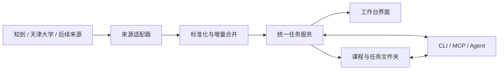

# 课程工作台

> ## 来源与致谢
>
> 本项目的产品构想、页面结构与界面布局、部分前端代码（`sync/app.html` 的页面骨架、课程与 DDL 弹窗及提示文案）改编自 [qianhan-111/campus-workbench](https://github.com/qianhan-111/campus-workbench)（「今天 · 校园课程工作台」）；早期的个人管理应用思路参考了 [qianhan-111/qianhan-app](https://github.com/qianhan-111/qianhan-app)。感谢原项目提供的产品思路与前端实现。
>
> 与原项目不同，本仓库的后端（Python 本地服务、Playwright 登录、教务与知到数据抓取、附件与答案管理、增量同步、Windows 单文件 EXE 打包）为独立实现。

面向 Windows 的本地课程工作台，连接天津大学教务和智慧树，集中查看课表、待办、考试、作业附件与平台返回的作业答案。当前程序版本为 **1.3.1**，首个 EXE 发行标签为 **release-v1.0**。

Windows 用户从 [release-v1.0 下载页面](https://github.com/BACKt2049/course-workbench/releases/tag/release-v1.0) 获取 `CourseWorkbench-Windows-x64.exe`，直接运行并选择数据目录，无需执行下面的源码安装步骤。修复范围与验收记录见 [发行说明](docs/releases/release-v1.0.md)。

项目的核心目标是减少跨平台寻找信息、整理要求、搬运附件和维护任务的时间。技术原理、使用条件、增量同步与任务状态设计、文件夹与 Agent 协作、稳定性及 GitHub Releases 更新路线见 [开发文档与演进方案](docs/development-plan.md)。文档区分当前实现与后续规划；SQLite 任务服务、Codex 工作区入口、MCP 和自动更新尚未实现。

## 功能

- 天津大学使用“融合门户”App 扫码，智慧树使用“知到”App 扫码。
- 同步课表、考试、作业要求、课程进度和附件；失败时保留已有数据。
- 按平台身份增量合并任务，保留已完成记录；本地工作状态与平台提交状态分别显示。
- DDL 页提供统一附件目录、绝对路径复制、上传、搜索、重命名、替换和删除。
- 答案中心支持筛选、刷新、复制与 TXT、Markdown、JSON 导出；缺失答案会标明状态。
- 首次桌面启动选择数据文件夹，已有数据可保留或复制迁移。
- 配置与业务 JSON 使用原子写入及有效副本恢复；自动备份保留最近 10 份。
- Windows EXE 内置 Python、Playwright 驱动和 Chromium。运行资源保存到稳定目录，缺失或损坏时从 EXE 恢复。

## 从源码运行

需要 Python 3.11 或更新版本。Windows 桌面模式使用系统文件夹选择器；命令行服务使用标准库 HTTP 服务。

```powershell
python -m venv .venv
.\.venv\Scripts\Activate.ps1
python -m pip install -r sync/requirements.txt
python -m playwright install chromium

# 桌面模式：首次选择数据目录
python sync/cli.py desktop

# 或仅启动本机服务
python sync/cli.py serve --no-lan
```

源码安装步骤用于开发环境；已经构建的 Windows EXE 不需要用户另装 Python、Node 或浏览器内核。

默认本机地址为 `http://127.0.0.1:8787`。桌面程序会处理已运行实例；端口占用时服务可选择可用端口。开发时也可以显式指定目录：

```powershell
$env:WB_DATA = 'D:\CourseWorkbenchData'
python sync/cli.py serve --no-lan
```

## 数据与备份

首次桌面启动选择数据目录。目录配置保存在 `%LOCALAPPDATA%\课程工作台\app-settings.json`，并保留有效副本。源码服务未显式指定目录时使用工作区的 `sync-data`。

| 子目录 | 内容 |
| --- | --- |
| `state` | 本地登录会话与服务状态 |
| `data` | 课表、待办、笔记与 `att` 附件目录 |
| `answers` | 按账号分开的答案缓存 |
| `backups` | 已校验的数据备份 |
| `runtime` | 从 EXE 恢复的页面、浏览器和驱动 |

“设置与数据”中可以查看目录并立即备份。仓库仅包含程序代码和合成测试样例，不包含个人会话、课程数据、附件、答案缓存、浏览器资料或备份。

## 测试

以下 79 项 Python 单元测试、36 项解析检查与 8 组前端回归不需要真实账号（前端检查使用 Node.js）：

```powershell
python -m unittest discover -s sync/tests -p test_answers.py -v
python -m unittest discover -s sync/tests -p test_attachments.py -v
python -m unittest discover -s sync/tests -p test_reliability.py -v
python -m unittest discover -s sync/tests -p test_task_sync.py -v
python sync/tests/test_parsers.py
node sync/tests/test_task_sync.cjs
```

原有课表与考试解析失败项已修复，并纳入 CI。`e2e_local.py` 是旧的手工联调脚本，会写测试数据，应使用独立的 `WB_DATA` 目录和对应测试服务。

## 构建 Windows 单文件 EXE

在 Windows 开发环境安装构建工具，并指定 Playwright 对应的 Chromium 缓存目录：

```powershell
python -m pip install pyinstaller
python -m playwright install chromium
$env:WB_BROWSER_SOURCE = "$env:LOCALAPPDATA\ms-playwright"
python -m PyInstaller --noconfirm --workpath output/build --distpath output/release sync/课程工作台.spec
```

成品为 `output/release/课程工作台-答案中心.exe`。构建配置会检查内核版本并嵌入完整内核；缺少匹配版本时拒绝构建。EXE、内核缓存和构建产物不会提交到源码仓库。

生成独立页面与源码压缩包：

```powershell
python sync/build_release.py
```

## 代码结构

- `sync/server.py`：本地接口、连接恢复、健康检查与备份入口。
- `sync/task_sync.py`：稳定任务身份、双状态与兼容旧数据的增量合并规则。
- `sync/runtime_config.py`、`durable_json.py`、`data_safety.py`、`runtime_assets.py`：目录选择、数据恢复、备份和运行组件恢复。
- `sync/browser_login.py`、`cas_qr.py`、`zhs_qr.py`、`zhs_client.py`：登录与平台会话。
- `sync/answers`：答案获取、解析、缓存和导出。
- `sync/parsers`：课程、考试、作业及进度解析。
- `sync/app.html` 与 `sync/web`：工作台界面。

项目设计与实施路线见 [开发文档与演进方案](docs/development-plan.md)，现有接口与运行说明见 [本地同步服务说明](sync/README.md)，日常使用见 [使用说明](答案中心-使用说明.txt)。

<details>
<summary><strong>展开阅读完整开发文档与演进方案</strong></summary>

+# 课程工作台：开发文档与演进方案

文档日期：2026-11-01。代码基线：1.3.0（`sync/app_info.py`）。面向维护者、贡献者和接续开发的 Agent。

**1.3.1 发行进展（release-v1.0）：** 已在现有 JSON 存储上修复任务增量合并、完成状态持久化、稳定平台身份关联及原有课表/考试解析失败，增加本地/平台双状态展示；默认仅本机监听，二维码使用就绪等待并合并重复登录请求。已有成品 EXE 和恢复验收，见 [发行说明](docs/releases/release-v1.0.md)。下文“当前缺陷”描述 1.3.0 的历史基线，不能据此认为上述问题在 1.3.1 仍未修复。SQLite、课程工作区、Agent API/CLI/MCP、签名自动更新、微信流与答案接口扩展仍未实现；数字提交状态未核实的映射仍显示未知。

## 来源与致谢

本项目的产品构想、页面结构与界面布局、部分前端代码（`sync/app.html` 的页面骨架、课程与 DDL 弹窗及提示文案）改编自 [qianhan-111/campus-workbench](https://github.com/qianhan-111/campus-workbench)（「今天 · 校园课程工作台」）；早期的个人管理应用思路参考了 [qianhan-111/qianhan-app](https://github.com/qianhan-111/qianhan-app)。感谢原项目提供的产品思路与前端实现。

本仓库的后端（平台登录与数据抓取、附件与答案管理、增量同步、单文件 EXE 打包、Agent 契约）为独立实现。

本文记录技术现状、已确认的产品决策和后续实现约定。**文档交付不代表 P0–P2 功能已完成。** “已实现”表示代码已有对应能力，不等于已通过所有发行环境验证；“需要修复”是现有缺口；“计划开发”是后续验收通过后才能启用的能力。

## 1. 产品目标与范围

**减少用户在多个平台之间寻找信息、整理要求、搬运附件和维护任务的时间。**

用户不应每天反复打开知到、天津大学融合门户、学习通和微信群聊，再手动把要求复制到另一个工具。工作台把用户可访问的信息整理成可追溯的任务和普通文件，让人或 Agent 接着工作。

目标流程：信息进入工作台 → 归并为任务 → 材料整理到文件夹 → 人或 Agent 执行 → 工作状态持续保存。

产品原则：

- 本地优先：保存的要求、附件和工作成果可离线使用，基础功能不依赖 AI 账号。
- 同步不破坏劳动成果：保留完成状态、备注、附件修改和产出；不把本次没抓到解释为删除。
- 数据可理解、可迁移：数据库管理事务，普通文件承载材料和成果，使用者不必依赖某个 AI 产品理解数据。
- 事实与判断分开：平台提交状态、本地工作状态、AI 提取结果分别记录，并保留来源。
- 接口可扩展：新平台接入来源适配器，避免把平台细节写进任务服务和界面。

已确认的范围与默认值：

| 决策 | 约定 |
| --- | --- |
| 首期验收平台 | Windows 11 x64；其他系统单列待验证 |
| 任务状态 | 本地工作状态与平台提交状态分开，明确的人工或 Agent 决定不被同步覆盖 |
| Agent 权限 | 可直接管理授权范围内的本地任务；平台提交、发消息等外部操作另行授权 |
| 更新策略 | 自动检查稳定版，提示后由用户确认安装 |
| 微信流 | 本轮不开发读取功能，后续参考 [WeFlow](https://github.com/hicccc77/WeFlow) |
| 答案接口 | 保留现有能力，爬取完整性与接口改进单独排期 |
| 个人数据 | 不提交到公开仓库，不随发行包分发，不默认上传 |

## 2. 当前技术原理与使用条件

### 2.1 现有运行链路

程序使用 Python 本地 HTTP 服务承载接口和页面，前端为 HTML/CSS/JavaScript。登录及动态页面通过 Playwright 驱动浏览器；平台接口请求与 HTML/JSON 解析得到课表、考试、任务、要求、附件及可获取的答案。

| 模块 | 当前职责 |
| --- | --- |
| [`cli.py`](sync/cli.py)、[`launcher.py`](sync/launcher.py)、[`server.py`](sync/server.py) | 命令入口、桌面启动、本地服务及页面 API |
| [`browser_login.py`](sync/browser_login.py)、[`pipeline.py`](sync/pipeline.py)、[`parsers/`](sync/parsers/) | 浏览器登录、平台拉取编排、解析 |
| [`store.py`](sync/store.py)、[`app.html`](sync/app.html) | JSON 汇总、前端状态及同步合并 |
| [`attachments.py`](sync/attachments.py)、[`answers/`](sync/answers/) | 附件管理、答案获取与缓存导出 |
| [`runtime_config.py`](sync/runtime_config.py)、[`runtime_assets.py`](sync/runtime_assets.py) | 数据目录、运行资源准备与恢复 |
| [`durable_json.py`](sync/durable_json.py)、[`data_safety.py`](sync/data_safety.py) | JSON 原子写入、有效副本恢复与备份 |

答案模块已有 provider/service/repository 分层，可借鉴其边界设计；它不等于已经具备通用多来源任务服务。

### 2.2 能力状态

| 能力 | 状态 | 实际边界 |
| --- | --- | --- |
| 天津大学、知到/智慧树接入 | 已实现 | 依赖用户有效会话及平台当前接口、页面结构 |
| 首次选择数据目录 | 已实现 | 桌面入口使用系统选择器；源码服务可用 `WB_DATA` 指定 |
| 内置 Python、Playwright 驱动及 Chromium | 已实现 | 发行构建检查匹配版本，运行时恢复到稳定目录；仍须做成品冷启动验收 |
| 统一附件目录与增删改查 | 已实现 | 目前主要是 `data/att`；并非完整的每课程、每任务 Agent 工作区 |
| JSON 恢复与自动备份 | 已实现 | 保留有效副本与最近 10 份普通备份；完整恢复入口及升级恢复点管理仍待补齐 |
| 任务查重、状态合并 | 需要修复 | 标题和截止时间参与 ID；前后端各自合并；平台提交状态未正确统一 |
| 默认仅本机访问 | 需要修复 | `serve --no-lan` 可限制为本机；当前桌面启动仍传入 `lan=True` |
| 二维码加载 | 需要优化 | 存在固定等待及重复启动浏览器成本，尚无统一耗时基线 |
| SQLite 任务服务、API/CLI/MCP | 计划开发 | 当前仍以 JSON 和整个工作台快照读写为主 |
| 课程工作区及一键交给 Codex | 计划开发 | 需实现导出、启动适配与桌面版本兼容性验收 |
| GitHub Releases 自动更新 | 计划开发 | 现有 CI 运行离线测试，不等于已有下载、安装、签名和回滚流程 |
| 学习通、微信流 | 计划开发 | 本轮只确定扩展边界，尚未接入 |

### 2.3 使用条件与内核说明

- 用户需要自己的平台账号及相应课程访问权限。天津大学使用“融合门户”App，智慧树使用“知到”App 扫码，不使用微信扫码。
- 正常构建的 Windows EXE 不要求另装 Python、Node、Playwright 或浏览器内核。首次运行会解压内置资源，后续复用稳定目录。打包意味着携带运行文件，不意味着浏览器可以不落盘运行。
- “校验内置组件”“从 EXE 恢复内置组件”“联网下载组件”是三种操作。发行版内置组件正常时不得显示“需要安装/正在下载内核”；恢复所需文件优先来自 EXE。
- 数据目录需要可写空间，容纳运行组件、材料、工作成果和备份。空间不足必须明确报告，不静默创建另一套空数据。
- 登录、同步和版本检查需要网络及平台可达；已保存的任务与材料应可离线使用。答案缓存还受当前账号上下文约束，不能把所有离线入口描述成同样完整。
- 源码开发使用 Python 3.11 或更新版本，按 [根目录 README](README.md) 安装依赖与 Chromium。开发环境安装步骤不适用于已经打包的 EXE。
- Codex 协作需要用户安装、登录 Codex，具备对应使用权限；基础工作台不要求 AI 账号或 API 密钥。

## 3. 目标架构与来源扩展接口

以下为计划架构：



来源适配器负责登录、课程和任务列表、任务详情、附件及平台状态映射。任务服务负责身份关联、查重、字段权限、状态合并、事务及审计。界面展示服务结果，不重复执行平台合并逻辑。

适配器注册信息包含来源名称、适配器版本和能力集合；未支持的能力返回“不支持”，不能伪造空列表当作成功。基础能力包括认证、课程列表、任务列表、任务详情、附件获取和平台状态读取。

每批获取结果至少提供：

| 字段组 | 必须表达的事实 |
| --- | --- |
| 来源身份 | provider、账号键、课程 ID、实体类型、平台实体 ID |
| 数据内容 | 标题、要求、期限、来源链接、附件引用及有证据的平台状态 |
| 抓取范围 | 全部课程、某课程、提醒窗口或特定任务，不能混用 |
| 时间与进度 | 抓取时间、上游更新时间（若有）、下一页或游标 |
| 完整性 | 抓取是否完整、失败项目、可重试错误、登录失效 |

平台支持游标时使用游标；否则允许全量获取后本地比对。**本地增量合并不等于上游一定提供增量 API。** 游标只在相应批次成功提交后推进，失败重试不得跳过未保存数据。

期限提醒列表不能作为完整任务库。对已知任务保留历史，按能力查询详情或提交状态；不能仅依靠“即将截止”的列表维护完成状态。

未来消息来源增加会话 ID、消息 ID、发送时间、附件和任务关联，保留原始消息引用。具体微信读取方式在后续阶段确定，不影响当前任务核心接口。

## 4. 任务身份、增量同步与双状态

### 4.1 当前缺陷及证据

`parsers/zhs_work.py` 的多条解析路径以标题和截止时间生成任务 ID，并给抓取结果设置 `done=False`。`pipeline.py` 调用按来源替换，`store.merge_latest` 与前端 `mergeSync` 分别保留同 ID 的本地字段。

因此标题或截止时间变化可能打断旧状态关联，同名同期限任务可能跨课程碰撞；保留旧 `done` 的逻辑也不能表达平台已提交这一新事实。它们是“设计模式习题二已完成却显示未完成”的候选原因，**还不是对该条真实任务的已验证归因**。P0 必须先用脱敏样例复现具体路径。

### 4.2 稳定身份与最小模型

内部 `taskId` 创建后不变。平台关联键为 `(provider, accountKey, courseId, kind, externalId)`，账号键是不含凭证的稳定本地标识。显示名、截止时间、目录名均不参与身份。

| 字段 | 约定 |
| --- | --- |
| `taskId`、`legacyIds`、`sourceRef` | 稳定内部身份、历史别名和平台关联 |
| `title`、`requirements`、`dueAt` | 平台事实与本地覆盖分别保存；期限保留时区，未知不伪造 |
| `workStatus` | `todo`、`in_progress`、`done` |
| `workStatusOrigin` | `automatic`、`user`、`agent`、`legacy`；记录是否存在明确本地决定 |
| `workStatusExplicit` | 是否禁止平台同步覆盖本地决定；人工和 Agent 设置状态时为真 |
| `submissionStatus` | `unknown`、`not_submitted`、`submitted`、`graded`、`returned`、`withdrawn` |
| `submissionObservedAt` | 状态证据时间；失败后保留上次可信观察供解释，但标记当前观察未知或过期 |
| `revision` | 业务修订号，用于并发写入检查 |
| `archivedAt`、`deletedAt` | 归档与本地删除记录；不等于平台撤回 |
| `parentTaskId` | 子任务关联；拆分本地任务不伪造平台任务 ID |

平台不给稳定 ID 时，记录待关联项；仅在课程、类型等上下文下唯一且有证据时关联旧任务。模糊匹配只产生建议，不自动合并两个可能不同的作业。

### 4.3 增量合并规则

1. 按账号和来源隔离获取结果，规范化后查找稳定关联键。
2. 新实体创建任务；已有实体只更新发生变化的来源字段；没有业务变化不增加任务或业务修订号。
3. 本地状态、备注、估时、子任务、手动附件与产出保留。来源字段的本地覆盖单独存储，不被下一次同步抹去。
4. 缺页、超时、返回空列表、提醒范围变化都不删除已有任务。本次未见只记录观察情况，不能自行推断撤回。
5. 本地删除保留 tombstone；再次拉取不自动恢复。恢复通过显式本地操作进行。
6. 附件优先按来源 ID 和版本比较，并以内容哈希核验；无可靠版本信息时需获取内容才能判断变化，不能仅因 URL 相同就认为未变。
7. 同步返回新增、更新、无变化、冲突、失败数量与明细。多个来源部分失败时保留已成功提交的数据。

### 4.4 状态决策表

| 本地情况 | 平台观察 | 处理 |
| --- | --- | --- |
| 无明确本地决定 | 已提交或已批改 | 可以自动完成，标注来自平台事实 |
| 用户或 Agent 明确完成 | 未提交 | 保留完成，显示“本地已完成 / 平台未提交” |
| 用户或 Agent 明确待办或进行中 | 已提交 | 保留本地决定，同时展示平台状态差异 |
| 任意状态 | 请求失败或状态字段缺失 | 不推断未提交，不重置本地工作状态 |
| 已完成 | 退回、撤回或重新开放 | 保留工作历史并提醒变化，由本地决定是否重开 |

平台数字状态码必须通过实际响应与界面对照验证，并建立脱敏测试样例。未知数字保留为未知，不能根据数值大小猜测语义。重新开放若没有对应枚举，作为平台变化事件记录，不擅自映射为未提交。

### 4.5 迁移与兼容

- 先保存旧 JSON 与恢复点，再建立稳定任务记录和别名映射，迁移可重复运行且不重复导入。
- `done=true` 保留完成。`done=false` 只表示旧本地待办，不证明平台未提交；缺少操作记录时不伪造人工决定。
- `latest.json` 与 `workspace.json` 不一致时保留两份证据；可唯一关联的完成记录优先保留，身份歧义进入冲突清单。
- 前端迁移到任务 API 后移除对任务的独立合并；其他工作台数据可继续使用快照接口。旧接口不得把整份旧 DDL 快照覆盖到新任务库。
- 不兼容客户端和旧程序拒绝写入新数据格式，提示升级或在副本中恢复；不得自动降级数据。

## 5. 数据管理与课程工作区

### 5.1 单一任务权威与普通文件

计划以 SQLite 管理任务元数据、来源关联、修订号、幂等结果和操作历史。界面、CLI、MCP 通过同一个任务服务写入，事务保证变更与审计一致。数据库备份使用一致性备份接口，不能直接复制正在写入的数据库而遗漏 WAL。

现有 JSON 是迁移输入；导出的 `task.json`、`tasks.json` 是可读投影，不是第二个权威写入口。数据库提交后可重试工作区导出，记录投影版本；导出失败不回滚已提交任务，也不假报工作区已经就绪。

附件和产出以普通文件保存，使用相对引用。内部数据库无需暴露给 Agent；便携工作区仍应在不运行工作台时清楚表达要求、来源和材料索引。

### 5.2 目标目录

```text
用户选择的数据目录/
├─ workspaces/
│  └─ 设计模式__课程短ID/
│     ├─ README.md
│     ├─ AGENTS.md
│     ├─ tasks.json
│     └─ 习题二__任务短ID/
│        ├─ task.json
│        ├─ requirements.md
│        ├─ attachments/
│        ├─ work/
│        └─ outputs/
├─ data/          内部数据库与附件原始版本
├─ answers/       现有账号隔离的答案缓存
├─ state/         登录凭证与程序状态
├─ raw/           私有诊断材料，不进入工作区
├─ backups/
└─ runtime/
```

课程目录映射包含账号范围，短 ID 避免不同账号同名课程相撞。名称去除 Windows 非法字符与保留名，控制长度；目录创建后保存映射，任务改名或延期不会自动搬走已有工作区。显式迁移目录保留映射并检查目标内容。

### 5.3 文件管理约定

- `requirements.md` 包含要求、期限、来源链接和抓取时间；来源要求更新保留版本。`task.json` 包含身份、双状态和修订号。
- `AGENTS.md` 来自受控模板，说明工作边界、任务接口和材料位置。外部网页或聊天内容不能直接拼成其中的执行指令。
- `work/` 与 `outputs/` 保留用户及 Agent 的修改，同步和投影重建不覆盖这两个目录。
- 工作区附件使用普通副本，避免可写硬链接导致 Agent 修改内部原件。记录上次导出哈希以识别本地改动；重命名、替换或删除保留本地覆盖及历史版本。
- 远端更新遇到本地改动时保留两者并列入冲突，不覆盖、不丢弃。通过应用进行的删除可恢复；应用外修改在重新扫描时识别。
- 首次迁移保留现有 `data/att` 与旧引用，核验完整后才切换引用，不能为整理目录直接移动或删除原件。
- DDL 保留统一附件入口；课程与任务增加打开目录、复制绝对路径及交给 Codex。上传、搜索、预览、重命名、替换、删除沿用可追踪原则。
- 工作区不包含 Cookie、token、认证响应、浏览器资料和敏感备份；复制绝对路径与导出内容均检查所选范围。

## 6. Codex 与 Agent 接口

本节接口均为计划接口，不应在使用说明中描述为 1.3.0 已可调用。

### 6.1 一键交给 Codex

点击课程或任务的“交给 Codex”后，先确保工作区投影完成，再通过 `codex://new?path=...&prompt=...` 打开新会话。对绝对路径和提示词分别进行 URI 编码；提示词引用本地要求和任务 ID，不夹带凭证，也不把抓取内容当作用户授权。

官方文档说明 `path` 可设定新会话工作区，`prompt` 用于预填，用户发送后开始执行。实现须对实际桌面版本验收，不能把操作系统接受链接等同于已成功创建会话。[Codex 官方说明](https://learn.chatgpt.com/docs/app/commands)

未安装、协议未注册或打开失败时提供目录与说明复制；检测到 CLI 时提供 `codex -C <绝对路径>` 入口。通过独立参数传递路径，不把文件名或要求拼接进 shell 命令。基本深链不负责自动安装 MCP 或修改全局 Codex 配置。

### 6.2 任务服务对外接口

本地 HTTP 命名空间固定为 `/api/v1`，CLI 与 MCP 只适配输入输出，复用任务服务。

| 能力 | 计划 HTTP 接口 | 行为 |
| --- | --- | --- |
| 查询任务 | `GET /api/v1/tasks`、`GET /api/v1/tasks/{id}` | 按课程、状态筛选，返回双状态和修订号 |
| 创建任务 | `POST /api/v1/tasks` | 创建本地任务，可关联课程及父任务 |
| 修改或完成 | `PATCH /api/v1/tasks/{id}` | 更新允许的本地字段，不伪造平台提交状态 |
| 拆分任务 | `POST /api/v1/tasks/{id}/split` | 在一个事务中创建子任务，父任务保持可追溯 |
| 归档、删除与恢复 | `POST /api/v1/tasks/{id}/actions` | 显式 action，保留历史或删除记录 |
| 查看与撤销操作 | `GET /api/v1/tasks/{id}/history`、`POST /api/v1/operations/{id}/undo` | 撤销作为新操作，检查受影响记录是否已有后续修改 |
| 准备工作区 | `POST /api/v1/tasks/{id}/workspace`、`POST /api/v1/courses/{id}/workspace` | 返回投影版本、目录及准备状态，不自动发送 AI 提示 |

修改请求携带预期 `revision`；版本冲突返回 409 和当前版本摘要。变更请求使用 `Idempotency-Key`：同键同内容重试返回已有结果，同键不同内容报冲突，防止网络重试重复创建任务。拆分和撤销涉及多条记录时在同一事务中检查和写入。

审计记录包含操作 ID、认证来源推导的操作者、时间、变更前后内容及关联任务；不能只相信调用者自行声称“我是用户”。平台同步也记入变更来源，便于解释状态变化。

### 6.3 CLI、MCP 与授权边界

计划在现有 CLI 下增加 `tasks` 子命令组及 `agent-mcp` 的 stdio 入口；MCP 提供与上述能力对应的结构化工具，不另写一套合并逻辑。Codex 支持 MCP 连接，安装和配置说明随接口实现一同提供。[MCP 官方说明](https://learn.chatgpt.com/docs/extend/mcp?surface=cli)

Agent 使用可撤销、限定课程或任务范围的本地凭证，不复用拥有全部权限的桌面 token。凭证不放进工作区、提示词、URL 或导出文件；CLI/MCP 经本地连接复用服务校验，程序未运行时返回明确连接状态。

授权范围内的查询、创建、拆分、修改、完成、归档和恢复不逐次确认。平台提交、发消息及账号操作不属于这些工具权限。Agent 直接改工作文件，业务元数据通过接口修改；把目录设为工作区不等于操作系统级安全隔离，服务仍须独立校验范围和路径。

## 7. 运行稳定性、备份与安全

- 程序文件、运行组件和用户数据分离。移动或替换 EXE 不改变已保存的数据目录配置。
- 配置损坏优先使用有效副本；无法恢复时引导定位已有数据，而不是静默创建空库。保留损坏文件和脱敏诊断信息。
- 配置和投影继续原子写入，任务持久化使用数据库事务。异常退出后检查恢复状态，不让多个实例同时迁移。
- 迁移在副本上执行，记录源格式、目标格式及进度，校验记录数、附件引用和关键状态后切换；原数据与备份保留。
- 继续定期备份，升级和迁移前额外备份。普通备份保留最近 10 份；当前升级恢复点单独固定，不参与普通轮转，直到升级验收完成。
- 备份覆盖任务、备注、状态、要求、附件、答案及 `workspaces` 的用户产出。运行组件可由发行包恢复，不占数据备份空间。
- 提供备份列表、完整性检查与恢复入口；恢复前再备份当前状态，在独立目录校验后切换，防止失败恢复破坏唯一数据。备份成功不等于已验证可恢复。
- 敏感状态与完整备份限制为当前用户访问，日志脱敏；工作区导出不包含凭证备份。SQLite 和 ZIP 本身不提供加密保证。
- 桌面服务默认改为回环监听；局域网访问需显式开启、认证及同源校验。保留 Host/Origin/token 校验，不把本机访问当作自动可信。
- 文件接口限定授权目录，拒绝路径穿越、越界绝对路径及指向边界外的符号链接或 Windows 目录联接。附件预览和来源文本按不可信内容处理。

## 8. 二维码性能与状态展示

当前登录存在固定等待和每次启动成本。先增加分段计时，再用导航、目标元素可见、二维码图像有效等事件替代无条件等待；不能以减少等待为由提前返回空二维码。

记录浏览器启动、页面访问、切换扫码页签、二维码就绪及用户扫码完成的独立时间。性能指标以“请求登录至有效二维码就绪”为准，不包含用户扫码等待；真实平台网络时间单独报告。

复用浏览器进程但隔离账号上下文，同一来源的重复登录请求合并到当前有效会话。过期二维码刷新，取消后释放资源；不使用过期截图冒充快速加载。避免跨线程共享 Playwright 对象。

同一机器、相同浏览器版本和固定测试页面下，分别建立冷启动、热启动基线，每组至少 30 次；目标是相应二维码就绪 P95 较基线下降至少 30%，同时维持成功率。该数字是验收目标，不是当前测量结果。真实平台另做烟雾测试并记录环境，不用不可控网络变化证明优化效果。

界面区分组件准备、页面加载、等待扫码、已过期及失败重试，持续标明“融合门户 App”或“知到 App”。

## 9. 版本与 GitHub Releases 更新

### 9.1 发布约定

公开仓库为 `BACKt2049/course-workbench`。GitHub Releases 发布版本说明和二进制附件，公开发布信息可通过 API 获取；它不替代客户端安装器、数据迁移和回滚。[GitHub Releases API](https://docs.github.com/en/rest/releases/releases)

应用使用语义化版本；数据格式独立使用递增 `schemaVersion`。每个发行版声明支持的 Windows 架构、最低更新器版本、可读取和可迁移的数据格式。稳定版和预览版分开，默认只检查稳定版。

发行流程：锁定依赖与浏览器版本 → 离线回归 → 隔离数据目录验收 → 干净 Windows 环境验证 EXE → 构建签名清单 → 发布附件。源码包、页面导出与完整 EXE 使用不同名称和明确说明，不能用不含内核的文件冒充完整发行包。

签名清单至少含应用版本、平台架构、附件名、大小、SHA-256、数据格式兼容范围和最低更新器版本。客户端内置发布公钥，验证清单签名后再验证文件哈希；单独 SHA-256 文件不能证明发布者身份。没有配置签名材料时禁止开启程序内安装，仍可提供官方发布页供用户手动获取。

签名私钥只存在发布环境的密钥管理中，不提交源码或打进 EXE。发布资产与版本固定，不在同一版本下悄悄替换文件。

### 9.2 客户端更新流程

默认启动后后台检查，距离上次检查不足 24 小时复用结果，并保留手动入口。检查失败、限流或离线不阻塞使用。下载和安装由用户确认触发。

1. 获取稳定版信息，比较版本与兼容范围，展示更新内容。
2. 下载到暂存目录，检查空间、签名、大小、哈希及当前版本是否仍兼容。
3. 等待本应用同步、Agent 写入及其他事务结束，进入维护状态，创建一致性恢复点。正在使用的工作文件若持续变化，延后更新并说明原因。
4. 写入持久化升级阶段记录；独立进程在主程序退出后替换 EXE，执行副本迁移。
5. 启动新版，验证进程、本地接口、数据库及内置运行组件；不把外部平台断网作为程序损坏。
6. 健康检查通过后解除维护状态，标记成功并按规则保留恢复点；失败恢复旧 EXE 与对应旧格式数据，不能让旧程序写新库。

磁盘不足、占用、断网、签名失败、迁移失败及阶段中断均保留当前可用版本。重启检查升级记录决定继续或回退，不盲目重复迁移。恢复不得覆盖升级后新成果；健康验收前不接受业务写入，异常情况保留新数据副本并提示处理。

## 10. 实施路线与验收门槛

### 10.1 分阶段交付

| 阶段 | 交付内容 | 完成门槛 |
| --- | --- | --- |
| 文档基线 | 本文、README 入口、旧说明校正、允许 `docs/` 进入仓库 | 链接有效，现状与规划明确，不含私人数据 |
| P0：同步正确性 | 脱敏复现、稳定身份、双状态、增量合并、历史兼容 | 状态与同步回归通过，旧数据可恢复，不猜测数字状态映射 |
| P1：Agent 协作 | SQLite 任务服务、工作区、API/CLI/MCP、Codex 入口 | UI 与 Agent 共用状态，并发、授权、投影、撤销及迁移验收通过 |
| P2：运行与发布 | 二维码优化、恢复入口及演练、发布流水线、签名更新与回滚 | 成品冷启动、性能和中断恢复矩阵通过 |
| 后续扩展 | 学习通、微信流、答案接口完善 | 各自立项、适配器样例与独立验收，不作为 P0–P2 完成前提 |

P0 先在现有存储上修复身份与合并，保留兼容映射；P1 将规则迁入统一任务服务，替换双端任务写入。P1 引入 SQLite 时必须同时具备一致性备份和迁移恢复，不能把前置保障推迟到 P2。

### 10.2 回归与发行验收清单

以下是待实施阶段的验收要求，不表示本文编写时已执行：

| 编号 | 场景 | 预期 |
| --- | --- | --- |
| T01 | 重复拉取同一批数据 | 任务数不变，无重复附件和多余业务修订 |
| T02 | 完成“设计模式习题二”后重拉、改名、延期 | 仍为同一任务，明确的本地完成状态保留 |
| T03 | 不同课程、账号出现同名同期限任务 | 不碰撞、不串联状态及附件 |
| T04 | 平台已提交、退回、撤回、未知状态码 | 按证据更新平台状态，本地决定保留，变化可解释 |
| T05 | 空列表、提醒范围变化、分页或单来源失败 | 不清空历史，成功结果保留，游标不越过未保存数据 |
| T06 | 删除后重拉、重复迁移、身份歧义 | 不自动复活或重复导入，歧义进入冲突清单 |
| T07 | 用户与 Agent 并发编辑，重试创建或拆分 | 修订冲突明确，幂等重试不重复，审计完整 |
| T08 | 撤销后又有编辑，越范围读写 | 不覆盖后续修改，不越权、不泄露凭证 |
| T09 | 工作区导出中断、目录重名、本地修改及远端更新 | 可重试、目录稳定、双方内容保留，产出不被覆盖 |
| T10 | 中文空格路径、未安装 Codex、协议不可用 | 正确编码和回退，不虚报打开成功 |
| T11 | 无 Python、Playwright、独立 Chromium 的干净 Windows 11 x64 环境 | EXE 可启动，内置组件准备不依赖联网下载 |
| T12 | 配置及有效副本损坏、临时目录清理、异常退出 | 可重新定位已有数据，损坏证据保留，已存数据可恢复 |
| T13 | SQLite 写入时备份与恢复，包含 Agent 产出 | 恢复一致，附件引用有效，成果齐全 |
| T14 | 二维码冷/热启动、重复点击、过期、取消 | 达到性能目标，无空码或过期码冒充成功 |
| T15 | 更新断网、占用、空间不足、篡改包、迁移失败与阶段中断 | 原版本可用或能回退，程序与数据格式匹配 |
| T16 | 旧客户端访问新库、升级后平台离线 | 旧客户端不能覆盖新数据，平台故障不触发错误回滚 |

现有 CI 运行答案、附件、可靠性三组共 60 项测试，命令见 [README](README.md#测试) 和 [测试工作流](.github/workflows/tests.yml)。这些是已有基线，不覆盖上表全部场景。历史 `test_parsers.py` 的 4 项失败须排查，修复解析行为或用有依据的脱敏/合成样例替换无效样例，再纳入发布门槛；不能为获得绿灯直接删除断言。

真实账号验证只在用户授权的本地数据上执行，公开测试使用合成或脱敏样例。端到端、迁移及恢复测试使用独立数据目录，禁止用日常数据作为可破坏测试夹具。每次发布记录版本、环境、结果及未验证项。

### 10.3 后续微信流与答案接口

微信流参考项目已确认是 [hicccc77/WeFlow](https://github.com/hicccc77/WeFlow)。进入该阶段时核查其当时的许可证、兼容版本、接口及导出格式，优先支持用户选择的聊天记录导入；当前阶段不依赖尚未验证的数据库读取实现，也不默认读取全部聊天记录。

提取任务保留会话、消息和附件依据，消息按不可信材料处理。重复导入按来源身份与内容版本查重；AI 推测的截止时间、责任人或任务应标注推断并供用户确认。自动发消息不属于该阶段默认范围。

答案接口另建问题清单，记录漏抓范围、可复现响应及平台是否开放答案；继续区分未公布、获取失败和部分可得。不得把抓取失败显示为“没有答案”，也不得据此改变任务完成状态。

## 11. 文档维护与参考资料

- 功能完成后附对应测试或发行验收证据，才能从“计划开发”改为“已实现”。
- 架构决策改变时同时更新接口、迁移与验收要求；纯文档更新不提升 EXE 版本。
- 新适配器需补齐身份、状态码证据、抓取完整性、错误处理和合成样例说明。
- 发布和恢复文档不得包含真实 Cookie、token、账号 UUID、私人课程响应或聊天记录。

参考资料（本次规划核查日期：2026-11-01）：

- [Codex 桌面深链：工作区路径与预填提示](https://learn.chatgpt.com/docs/app/commands)。
- [Codex CLI 参数](https://learn.chatgpt.com/docs/cli/reference)。
- [Codex MCP 接入](https://learn.chatgpt.com/docs/extend/mcp?surface=cli)。
- [GitHub Releases API](https://docs.github.com/en/rest/releases/releases)。
- [WeFlow 参考项目](https://github.com/hicccc77/WeFlow)。


</details>
